## Affine Tracing {#slide-01 .uos-title .no-heading}

::: {.uos-logo}
{fig-alt="University of Southampton"}
:::

::: {.big-title}
Affine Tracing
:::

::: {.big-subtitle}
A New Paradigm for Implementing Probabilistic Linear Solvers
:::

::: {.author-block}
**Jon Cockayne**<br>
CORMSIS Seminar, 7 May 2026
:::

::: {.notes}
Iterations of IPMs require solutions of large linear systems.Second order optimisation - Newton type methods involve the inverse Hessian at each iteration.
:::

## Papers {#papers-opening}

**Affine Tracing: A New Paradigm for Probabilistic Linear Solvers**<br>
Hegde, Pförtner and Cockayne (NeurIPS 2026)<br>
[arxiv.org/abs/2605.10566](https://arxiv.org/abs/2605.10566)

**Calibrated Computation-Aware Gaussian Processes**<br>
Hegde, Adil and Cockayne (AISTATS 2025)<br>
[proceedings.mlr.press/v258/hegde25a.html](https://proceedings.mlr.press/v258/hegde25a.html)

<!-- Keynote slide 2 -->
## Co-Authors {#slide-02}

- Disha Hegde (UoS)

- Mohamed Adil

- Chris Oates (Newcastle)

- Ilse Ipsen (NC State University)

- Tim Reid

::: {.notes}
ECMWF - ERA5 reanalysis dataset. Sea surface temperatures.Most of the time to fit a regression model you need to invert a matrix and the dimension depends on how much data you have.17 trillion data points
:::

<!-- Keynote slide 3 -->
## Outline {#slide-03}

1. GP Regression

2. Probabilistic Numerics and Probabilistic Linear Solvers

3. Computation-Aware GPs

4. Affine Tracing

5. Results

::: {.notes}
Nonparametric regression, nonlinear, conjugacy, UQ
:::

<!-- Keynote slide 4 -->
## Part 1: Linear Systems {#slide-04 .section-slide}


::: {.notes}
Some work using iterative solvers.Structure in G - e.g. circulant methodsIterative methods - e.g. CGGP
:::

<!-- Keynote slide 5 -->
## Linear Systems {#slide-05}

- We focus on linear systems of the form

$$Ax = b$$

- Standard solvers (LU, QR, Cholesky) require $\mathcal{O}(d^{3})$ compute to solve.

- Iterative Solvers produce a sequence $(x_{i}) \rightarrow x$.

- If the error $x_{i} - x$ can be made small for small enough $i$, they are more efficient

::: {.notes}
Fast convergence = fast contraction.What we really care about is the error representation, the UQ. Much as with GPs, there is no point in using these methods unless they have this.
:::

<!-- Keynote slide 6 -->
## Why Should You Care? {#slide-06}

- Second order optimisation.

- Linear Programming (e.g. interior point methods).

- Least-squares problems

- ...essentially any numerical pipeline.

::: {.notes}
This works with any prior / iterative method.We have this commutative diagram but there are some gaps we need to fill.From this (generic) structure we don’t have a relationship between the point estimates and the measures
:::

<!-- Keynote slide 7 -->
## Big (GP) Regression Problems {#slide-07}

::: {.columns}
:::: {.column width="40%"}

{.figure fig-alt="ERA5 temperature observations"}

::::
:::: {.column width="60%"}

- $\approx$ 1 million observations per time point.

- Hourly time points since 1940.

- About $17 \times 10^{12}$ total data points.

- GP regression methods are $\mathcal{O}(d^{3})$!

::::
:::

::: {.notes}
Gaussian prior and affine method.
:::

<!-- Keynote slide 8 -->
## (My) Motivation: GP Regression / Kriging {#slide-08 .compact}

- Start from an initial prior distribution $u \sim \mu_{0}:= \mathcal{GP}(m_{0},k_{0})$.

- Assume the data-generating model (DGM):

- $y = u(X_{\text{tr}}) + \zeta$, $X_{\text{tr}} \in \mathcal{X}^{d}$, $\zeta \sim \mathcal{N}(0,\sigma^{2}I)$

- We then update to the **conditional distribution** $u \mid y \sim \mu^{y}:= \mathcal{GP}(m,k)$

$$\begin{aligned}
m(x) &= m_{0}(x) + k_{0}(x,X_{\text{tr}})A^{- 1}(y - m_{0}(X_{\text{tr}})) \\
k(x,x') &= k_{0}(x,x') - k_{0}(x,X_{\text{tr}})A^{- 1}k_{0}(X_{\text{tr}},x') \\
A &= k_{0}(X_{\text{tr}},X_{\text{tr}}) + \sigma^{2}I
\end{aligned}$$

::: {.notes}
Leading order in both m and d - cubic cost in m comes from matrix inversion.
:::

<!-- Keynote slide 9 -->
## Posterior Computation and Linear Algebra {#slide-09 .compact}

$$\begin{aligned}
u \mid y &\sim \mu^{y}:= \mathcal{GP}(m,k) \\
m(x) &= m_{0}(x) + k_{0}(x,X_{\text{tr}})A^{- 1}(y - m_{0}(X_{\text{tr}})) \\
k(x,x') &= k_{0}(x,x') - k_{0}(x,X_{\text{tr}})A^{- 1}k_{0}(X_{\text{tr}},x')
\end{aligned}$$

- $A \in \mathbb{R}^{d \times d}$. Standard "direct" solver:

- Compute $A = LL^{\top}$, $L$ triangular \[$\mathcal{O}(d^{3})$\]

- Perform forward / backward substitution \[$\mathcal{O}(d^{2})$\]

::: {.notes}
This relationship is because the Bayesian approach is noise free, so all the conditioning does is collapse the prior along certain directions. i.e., a projection. And we can show it is orthogonal wrt the prior.
:::

<!-- Keynote slide 10 (skipped) -->
## Code Demo 1 {#slide-10 .section-slide visibility="hidden"}


::: {.notes}
We might be worried about UQ from PIMs. Lots of reasons for Bayesian UQ to be good. With PIMs I just “did some stuff” and a distribution popped out. Why should this be any good?
:::

<!-- Keynote slide 11 (skipped) -->
## GP Approximation {#slide-11 visibility="hidden"}

- We cannot always afford to pay $\mathcal{O}(d^{3})$!

- **GP approximation** methods aim to address this:

- Fourier Features

- Structured Kernel Methods

- SDE-Based (Lindgren)

- Sparse / Inducing Points (FITC / Nystrom / Variational)

::: {.notes}
To provide intuition: how would we check if Gaussian posteriors were “good”Assume access to truth - this is unrealistic in practise but necessary for a formal definitionWant truth to look like a sampleZ score.Doesn’t say anything based on one truthSample many truths, many z scores, hopefully N(0, I)
:::

<!-- Keynote slide 12 (skipped) -->
## Challenges {#slide-12 visibility="hidden"}

- There are **few guarantees** on the UQ provided by these methods.

- It can be *very* overconfident1.

- This talk: Novel GP approximation methods based on applying a **probabilistic linear solver** to solver the linear system and **propagating the uncertainty** to the GP.

- We are able to obtain (subjective) guarantees on the UQ provided.

::: {.references}
1\. Jonathan Wenger et al. "Computation-Aware Gaussian Processes: Model Selection And Linear-Time Inference". In: NeurIPS 2024 (2024). DOI: 10.52202/079017-0984.
:::

::: {.notes}
This is a special case of a more general notion of calibration, specialised to methods with Gaussian prior and posterior.Sometimes there are problems with rank(\Sigma), but these are solvable.
:::

<!-- Keynote slide 13 -->
## Part 2: Probabilistic Numerics and Probabilistic Linear Solvers {#slide-13 .section-slide}


::: {.notes}
This is a reasonable property - it being a fixed point essentially means we would be willing to use it as a linear solver.Banach Fixed Point Theorem might suggest we want the PLS to also be a contraction - but this is not required for calibration (we don’t need the posterior to converge, so long as the truth still looks like a realistic sample).In other words, it’s fine for the mean to shoot off to infinity as long as the covariance tells us it’s doing that.
:::

<!-- Keynote slide 14 -->
## Numerical Problems {#slide-14}

- Given a problem space $\mathcal{A}$ and solution space $\mathcal{X}$, a **numerical method** is a function:

$$f:\mathcal{A} \rightarrow \mathcal{X}$$

- For a problem $P \in \mathcal{A}$ with solution $x \in \mathcal{X}$, **good** numerical methods have $f(P) \approx x$.

::: {.notes}
Turn the problem of choosing search directions into a problem of solving a linear system.
:::

<!-- Keynote slide 15 -->
## Example: NLA {#slide-15}

- Problem: find $x$ in $Ax = b$.

- $\mathcal{X} = \mathbb{R}^{d}$, $\mathcal{P} = \left\{ (A,b):A \in \mathbb{R}^{d \times d},b \in \mathbb{R}^{d},A\text{invertible} \right\}$

- Measure **approximation error** through the error norm $\parallel f((A,b)) - x \parallel$

::: {.notes}
Some work using iterative solvers.Structure in G - e.g. circulant methodsIterative methods - e.g. CGGP
:::

<!-- Keynote slide 16 -->
## Example: NLA {#slide-16}

::: {.columns}
:::: {.column width="64%"}

### Examples of Numerical Methods

- LU Factorisation:

- Computes $x$ exactly (ignoring precision), $\mathcal{O}(d^{3})$.

- Iterative Methods:

- Richardson *(GD)*: $f((A,b);x_{i}) = x_{i} + (b - Ax_{i})$

- Each application $\mathcal{O}(d^{2})$ *but converges rather slowly*.

- Many others - e.g. Krylov methods *(CG)*, multigrid, semi-iterations...

::::
:::: {.column width="36%"}

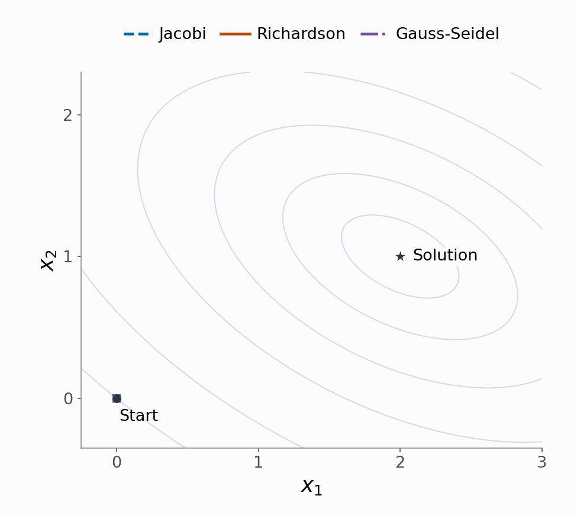{.figure fig-alt="Animated convergence of an iterative linear solver"}

::::
:::

::: {.notes}
A very special choice of prior that looks quite difficult to justify at this point.We will see how this posterior belief arises later.We see that the inverse disappears, and we are left with the downdate. So if we can compute these without G^{-1} it’s okay.
:::

<!-- Keynote slide 17 -->
## Early Stopping {#slide-17}

::: {.columns}
:::: {.column width="68%"}

- An iterative method is a sequence

- $(x_{i})$ $x_{i} \in \mathbb{R}^{d}$

- Running to convergence can still be expensive.

- Terminating an iteration early leaves error unquantified.

- Existing "worst case" bounds are typically very conservative.

::::
:::: {.column width="32%"}

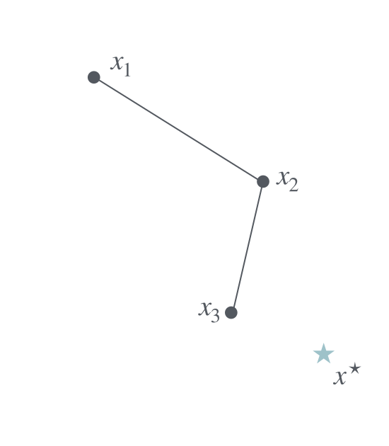{.diagram fig-alt="Iterates approaching the solution"}

::::
:::

::: {.notes}
Subjective Bayesian setting - UQ is correct provided that the model is correctly specified. (i.e. prior and DGM is correct).This is assured by the GP being correctly specified.
:::

<!-- Keynote slide 18 -->
## Probabilistic Numerics {#slide-18}

::: {.columns}
:::: {.column width="68%"}

- A **probabilistic iterative method** is a sequence

- $(\mu_{i})$ $\mu_{i} \in \mathcal{P}(\mathbb{R}^{d})$

- "Uncertainty" describes the error.

- Probabilistic numerical methods are good if:

- They converge quickly (i.e. $\mu_{i}(B_{\epsilon}^{\mathsf{c}}(x^{\star}))$ is small) **and**

- $\mu_{i}$ *typically* provides a *good representation of the error*.

::::
:::: {.column width="32%"}

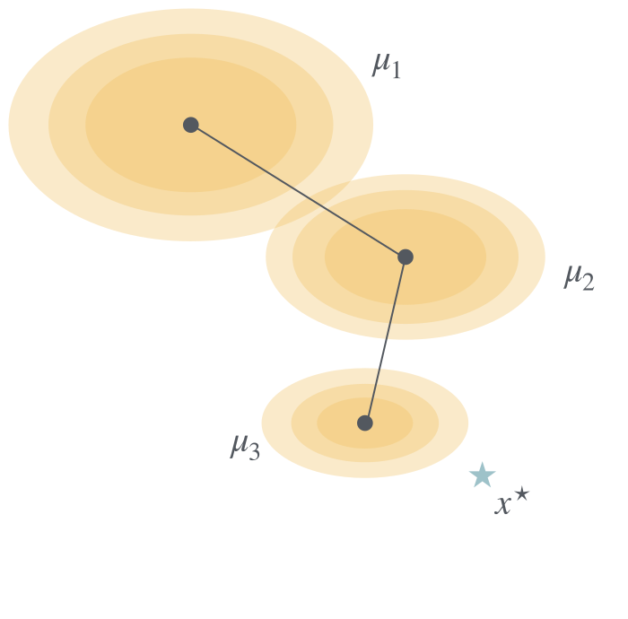{.diagram fig-alt="Probability distributions describing the error of successive iterates"}

::::
:::

::: {.notes}
“Nice” essentially means the true solution is a fixed point of the linear system.Minimal requirement since, if we reach the true solution, we do not want to leave it.“Canonical form”
:::

<!-- Keynote slide 19 -->
## 2.1: Building PLSs {#slide-19 .section-slide}


::: {.notes}
Sketch how we build one of these solvers.Broad class that is Bayesian. Take these projections from earlier.Leading order in both m and d - cubic cost in m comes from matrix inversion.Use Krylov directions for S_m - BayesCG.
:::

<!-- Keynote slide 20 -->
## Probabilistic Iterative Methods for Linear Systems {#slide-20 .no-heading}

{.paper fig-alt="Probabilistic Iterative Methods for Linear Systems, article title page"}

::: {.notes}
However - it is quite complicated (and PLS-specific) to compute them.We also need separate implementations under the inverse prior and general priors, to do manual cancellations.
:::

<!-- Keynote slide 21 -->
## Iterative Methods {#slide-21}

- A (degree 1) iterative method is a sequence of maps $(P_{i})_{i = 1}^{\infty}$, $P_{i}:\mathbb{R}^{d} \rightarrow \mathbb{R}^{d}$.

- Given an initial iterate $x_{0}$, we generate the sequence $x_{i} = P_{i}(x_{i - 1})$.

- We let $P^{i} = P_{i} \circ \ldots \circ P_{1}$, i.e. $x_{i} = P^{i}(x_{0})$.

::: {.notes}
For CAGP-GS we have calibration guarantees, borne out empirically. But slow mean-field convergence.For CAGP-CG we lose calibration but fast mean-field convergence.Other methods could be faster?
:::

<!-- Keynote slide 22 -->
## Pushforward Methods {#slide-22}

::: {.columns}
:::: {.column width="68%"}

- We lift the maps to probability space.

- Given an initial random variable $X_{0}$, $X_{i} = P_{i}(X_{i - 1})$.

- If $X_{0} \sim \mu_{0}$, $X_{i} \sim \mu_{i}$ where $\mu_{i} = (P_{i})_{\sharp}\mu_{i - 1}$.

- (Hence why these are called "pushforward methods")

::::
:::: {.column width="32%"}

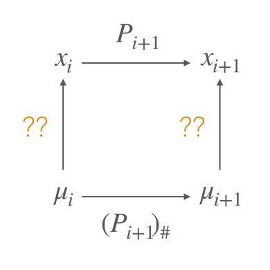{.diagram fig-alt="Pushforward maps between iterates and probability measures"}

::::
:::

::: {.notes}
Step through this a bit carefully because it’s neatAdd this thing related to the covariance over v
:::

<!-- Keynote slide 23 -->
## Gaussian-Affine PLS {#slide-23 .compact}

::: {.columns}
:::: {.column width="68%"}

- Many iterative methods are affine:

$$P_{i}(x) = M_{i}x + f_{i}\quad M_{i} \in \mathbb{R}^{d \times d},f_{i} \in \mathbb{R}^{d}$$

- Using a Gaussian prior $\mu_{0} = \mathcal{N}(x_{0},\Sigma_{0})$ we have

$$\mu_{i} = \mathcal{N}(x_{i},\Sigma_{i})\quad\Sigma_{i} = M_{i}\Sigma_{i - 1}M_{i}^{\top}$$

::::
:::: {.column width="32%"}

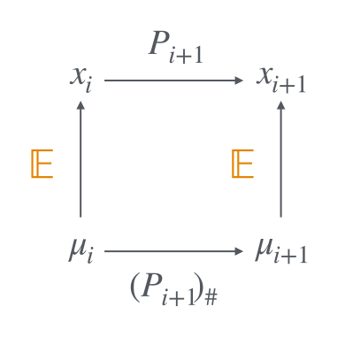{.diagram fig-alt="Expectation commutes with affine pushforward maps"}

::::
:::

::: {.notes}
Why would we do thisAdditional error on top of the mathematical UQ from the GP that represents reduced computational effort.
:::

<!-- Keynote slide 24 -->
## Approach 2: Bayesian Methods {#slide-24}

- Phrase this as a **Bayesian inference problem**:

- Take $x \sim \mu_{0}:= \mathcal{N}(x_{0},\Sigma_{0})$

- Condition on **data** of the form $s_{i}^{\top}Ax^{\star} = s_{i}^{\top}b$, $i = 1,\ldots,m$, where $S_{m} = \lbrack s_{1},\ldots,s_{m}\rbrack \in \mathbb{R}^{d \times m}$ has rank $m$.

::: {.notes}
Operates on multiple approximations of the matrix, usually based on different meshings of the domain (grids) in PDEsNot important to understand exactly what is happening here. The issue is that because we pass through multiple subroutines, these all need to be augmented and the cross covariances between intermediate quantities need to be tracked, to get our posterior belief.
:::

<!-- Keynote slide 25 -->
## Bayesian PLS {#slide-25 .compact}

- Posterior:

$$\begin{aligned}
x \mid S_{m}^{\top}b &\sim \mu_{m} = \mathcal{N}(x_{m},\Sigma_{m}) \\
x_{m} &= x_{0} + S_{m}(S_{m}^{\top}A\Sigma_{0}A^{\top}S_{m})^{- 1}S_{m}^{\top}b \\
\Sigma_{m} &= \Sigma_{0} - S_{m}(S_{m}^{\top}A\Sigma_{0}A^{\top}S_{m})^{- 1}S_{m}^{\top}
\end{aligned}$$

- The matrix inside the inverse is $m \times m$.

- Cost: $\mathcal{O}(m^{3} + md^{2})$ compute.

- (Methods exist to reduce this cost)

::: {.notes}
Green line - SOA mean convergence, poor UQ.
:::

<!-- Keynote slide 26 -->
## Bayesian Methods are Pushforward Methods {#slide-26 .compact}

- Previous work gives the impression that these are **separate methodological approaches**.

::: {.theorem}
**Theorem (Coming Soon)**

Let $(P_{i})$ be a sequence of affine iterative methods with fixed point $x^{\star}$. Then the PIM associated with $P^{i}$ is a Gaussian-affine **Bayesian** PLS with information $S_{i}$ if and only if $P_{i}$ orthogonally projects onto $\ker(\Sigma_{0}AS_{i})$ with-respect-to the $\Sigma_{0}^{- 1}$ inner-product.
:::

::: {.notes}
Issue comes from the fact that the algorithm is broken down into subroutines.If we could extract these matrices we would be okay - but they are usually implicit.
:::

<!-- Keynote slide 27 -->
## 2.2: Calibrated PLSs {#slide-27 .section-slide}


::: {.notes}
This is what an implementation might look likeInstead of passing in a vector we pass in an object that “behaves like” a vector.Records all the affine operations performed on it and represents them in a Graph structure.Green = multiply, orange = shift
:::

<!-- Keynote slide 28 -->
## Calibration of Gaussians {#slide-28}

::: {.columns}
:::: {.column width="58%"}

<div class="calibration-figure" role="group" aria-label="Gaussian calibration: the original Keynote build sequence">
  
  
  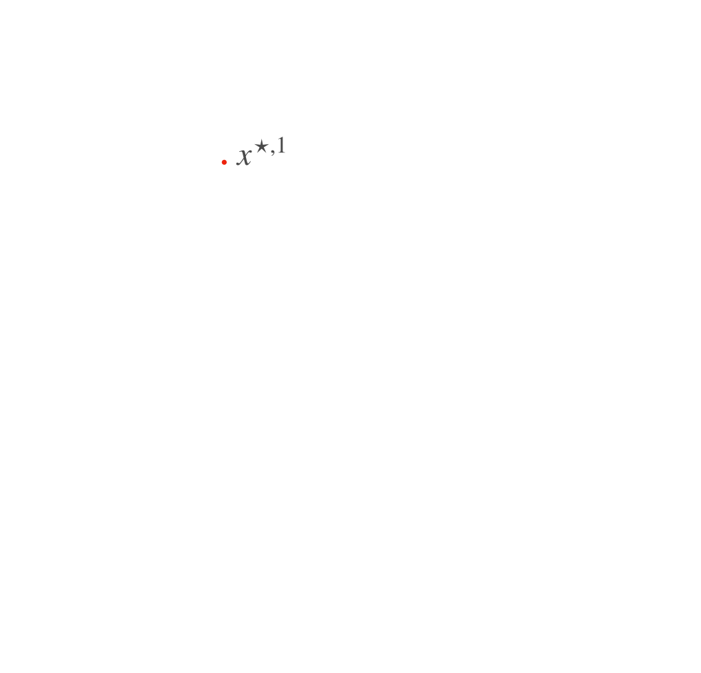
  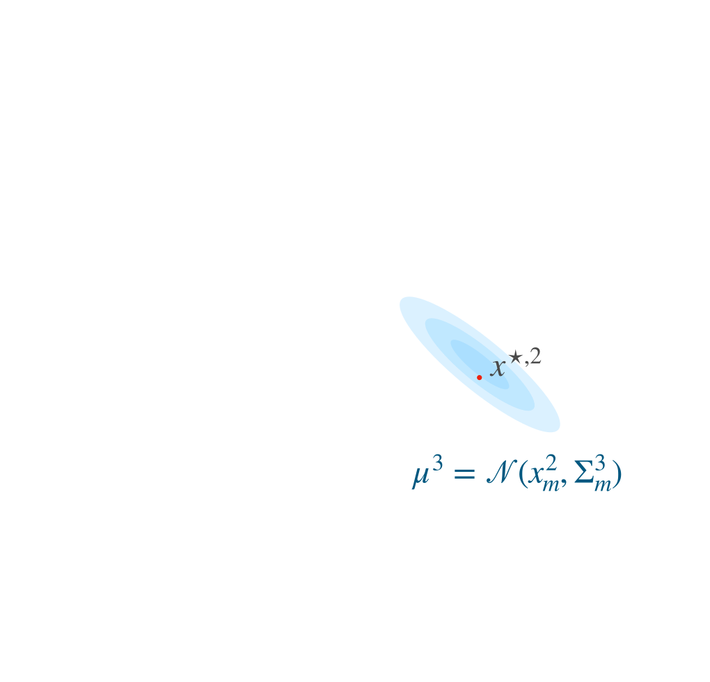
  
  
</div>

::::
:::: {.column width="42%"}

::: {.fragment .calibration-build data-fragment-index="0"}
$$z_{i} = (\Sigma_{m}^{i})^{- \frac{1}{2}}(x_{m}^{i} - x^{\star ,i})$$
:::

::: {.fragment .calibration-build data-fragment-index="1"}
$\mu_{0}$ the prior: an ensemble of problems we wish to test calibratedness wrt.
:::

::: {.fragment .calibration-build data-fragment-index="2"}
$$\begin{aligned}
x^{\star ,i} &\sim \mu_{0} \\
z_{i} &\sim N(0,I)
\end{aligned}$$
:::

::::
:::

::: {.notes}
We can then manipulate the graph structure - apply it to iterate meanOr delete shifts and apply it to get covariance iterations.Notably - this forms a new graph that can be simplified.
:::

<!-- Keynote slide 29 -->
## Calibration of Gaussian-Affine PLSs {#slide-29 .compact}

::: {.theorem}
**Strong calibration ([Definition 2.1](https://arxiv.org/html/2605.10566v2))**

Let $\mu_{i} = \mathcal{N}(x_{i},\Sigma_{i})$ be the PLS output with $\Sigma_{i}$ independent of $x^{\star}$. Let the columns of $R$ and $N$ form bases for the range and kernel of $\Sigma_{i}$, respectively, and let $r=\operatorname{rank}(\Sigma_{i})$.

The PLS is **strongly calibrated** if, for $x^{\star} \sim \mu_{0}$ and $b=Ax^{\star}$,

$$\begin{aligned}
(R^{\top}\Sigma_{i}R)^{-1/2}R^{\top}(x_{i}-x^{\star}) &\sim \mathcal{N}(0,I_{r}), \\
N^{\top}(x_{i}-x^{\star}) &= 0.
\end{aligned}$$
:::

::: {.notes}
We can then manipulate the graph structure - apply it to iterate meanOr delete shifts and apply it to get covariance iterations.Notably - this forms a new graph that can be simplified.
:::

<!-- Keynote slide 30 -->
## Calibration of Gaussian-Affine PLSs {#slide-30}

::: {.theorem}
**[Theorem 3.3](https://arxiv.org/html/2605.10566v2)**

Let $\mu_{0}=\mathcal{N}(x_{0},\Sigma_{0})$ with $\Sigma_{0}$ symmetric positive definite. For an affine iterative method solving $Ax^{\star}=b$, let $P^{i}$ be the map taking $x_{0}$ to $x_{i}$. Assume $P^{i}(x^{\star})=x^{\star}$ and that its linear part is independent of $b$.

Then the associated PIM $\mu_{i}=(P^{i})_{\sharp}\mu_{0}$ is **strongly calibrated**.
:::

::: {.notes}
Challenge: working with inverse priors is still hard.Express in canonical form.Gain a new (equivalent) graph.
:::

<!-- Keynote slide 31 -->
## Part 3: Computation-Aware GPs {#slide-31 .section-slide}


::: {.notes}
Notice there is again some simplification. Simplify the graph and we get out the downrate form.
:::

<!-- Keynote slide 32 -->
## Computation-Aware Gaussian Processes {#slide-32 .no-heading}

{.paper-half fig-alt="Paper on computation-aware Gaussian processes"}

{.paper-half fig-alt="Paper on computation-aware Gaussian processes"}

::: {.notes}
Automating this is hard. E-graphs provide a solution - essentially define equivalence rules, like distributivity, A * A^{-1} = I. Attach costs to each operation, make A^{-1} very expensive, and then simplify.Could even give us a way to automatically derive canonical form!What we want to do is structured, so maybe there is an easier way.Cost specific - also simplify low-dimensional projections, multigrid.“More complex” - apply this to other problems than linear systems?
:::

<!-- Keynote slide 33 -->
## Recap: Gaussian Processes {#slide-33 .compact}

$$\begin{aligned}
u \mid y &\sim \mu^{y}:= \mathcal{N}(m,k) \\
m(x) &= m_{0}(x) + k_{0}(x,X_{\text{tr}})A^{- 1}(y - m_{0}(X_{\text{tr}})) \\
k(x,x') &= k_{0}(x,x') - k_{0}(x,X_{\text{tr}})A^{- 1}k_{0}(X_{\text{tr}},x')
\end{aligned}$$

- Standard solvers incur $\mathcal{O}(d^{3})$ computation.

- Goal: fast, calibrated GP posteriors.

<!-- Keynote slide 34 -->
## Reparameterisation {#slide-34 .compact}

- Let $v$ be the solution to the linear system $Av = y - m_{0}(X_{\text{tr}}) = :b$.

- We have $u \mid v,y \sim \mu^{y}(v) = \mathcal{N}(m( \cdot ;v),k)$

$$\begin{aligned}
m(x;v) &= m_{0}(x) + k_{0}(x,X_{\text{tr}})v \\
k(x,x') &= k_{0}(x,x') - k_{0}(x,X_{\text{tr}})A^{- 1}k_{0}(X_{\text{tr}},x')
\end{aligned}$$

<!-- Keynote slide 35 -->
## The "Marginalisation Trick" {#slide-35 .compact}

- Apply a **probabilistic linear solver** to solve $Av = b$.

- Obtain a posterior belief $v \sim \nu:= \mathcal{N}(\overline{v},A^{- 1} - D)$.

- Marginalise $v$:

$$\begin{aligned}
m(x;v) &= m_{0}(x) + k_{0}(x,X_{\text{tr}})v \\
k(x,x') &= k_{0}(x,x') - k_{0}(x,X_{\text{tr}})A^{- 1}k_{0}(X_{\text{tr}},x')
\end{aligned}$$

$$\mapsto\quad \begin{aligned}
\tilde{m}(x) &= m_{0}(x) + k(x,X_{\text{tr}})\overline{v} \\
\tilde{k}(x,x') &= k_{0}(x,x') - k_{0}(x,X_{\text{tr}})Dk_{0}(X_{\text{tr}},x')
\end{aligned}$$

<!-- Keynote slide 36 -->
## Calibration of CAGPs {#slide-36 .compact}

::: {.theorem}
**Theorem (Theorem 4 of \[1\])**

Assume that the GP model is strongly calibrated (in the sense of \[2\]) for $(\mu_{0},\text{DGM})$, and that the PLS is strongly calibrated for $N(0,A^{- 1})$ (plus some additional mild technical conditions).

Then the CAGP posterior is strongly calibrated for $(\mu_{0},\text{DGM})$.
:::

::: {.references}
Hegde, D., Adil, M., & Cockayne, J. (2025). Calibrated computation-aware Gaussian processes. *AIStats 2025.* doi:10.48550/ARXIV.2410.08796

Cockayne, J., Graham, M. M., Oates, C. J., Sullivan, T. J., & Teymur, O. (2022). Testing Whether a Learning Procedure is Calibrated. *Journal of Machine Learning Research*, *23*(203), 1--36. Retrieved from http://jmlr.org/papers/v23/21-1065.html
:::

<!-- Keynote slide 37 -->
## The Inverse Prior {#slide-37}

How do we obtain such a posterior belief?

::: {.theorem}
**[Lemma 3.2](https://arxiv.org/html/2605.10566v2)**

Let $(P_{j})$ be a sequence of first-order affine iteration maps for $Ax^{\star}=b$ with $P_{j}(x^{\star})=x^{\star}$ for every $j$. For each $i$ there is a matrix $\overline{M}_{i}$ such that

$$P^{i}(x) = (I - \overline{M}_{i}A)x + \overline{M}_{i}b.$$
:::

For symmetric positive definite $A$, the inverse prior $\mu_{0} = \mathcal{N}(x_{0},A^{-1})$ gives

$$\Sigma_{i} = A^{-1} - D_{i},$$

where the downdate $D_{i}$ can be expressed in terms of $A$ and $\overline{M}_{i}$.

<!-- Keynote slide 38 -->
## ...but how do we get the downdate? {#slide-38}

- Straightforward to show:

$$D_{i} = {\overline{M}}_{i} + {\overline{M}}_{i}^{\top} - {\overline{M}}_{i}A{\overline{M}}_{i}^{\top}$$

- But ${\overline{M}}_{i}$ is **only available implicitly** - it needs to be computed on paper **for every new PIM** and for **every iteration number.**

<!-- Keynote slide 39 (skipped) -->
## Using the Inverse Prior {#slide-39 visibility="hidden"}

- We build these posteriors using the **inverse prior** $\mu_{0} = \mathcal{N}(0,G^{- 1})$

- For all "nice" iterative methods the posterior has the form $\mathcal{N}(\overline{v},G^{- 1} - D)$.

- (This is because all such PLSs can be expressed as $M = (I - \tilde{M}A)$ for some $\tilde{M}$.)

- $\overline{v}$ and $D$ are (provably) independent of $G^{- 1}$.

- However some challenges remain...

<!-- Keynote slide 40 (skipped) -->
## 3.1 PLSs with Inverse Priors {#slide-40 .section-slide visibility="hidden"}


<!-- Keynote slide 41 (skipped) -->
## Computing the Downdate {#slide-41 visibility="hidden"}

- Downdates can typically be computed without $A^{- 1}$ but may still cost $\mathcal{O}(d^{3})$.

- We often target low dimensional summary statistics of the posterior, i.e.

$$V^{\top}X_{m} \sim \mathcal{N}(V^{\top}X,V^{\top}(A^{- 1} - D_{m})V)$$

$V^{\top}D_{m}V$ often computable at $\mathcal{O}(rank(V)d^{2})$

<!-- Keynote slide 42 (skipped) -->
## With Bayesian PLSs {#slide-42 .compact visibility="hidden"}

- Example: $v \sim \mathcal{N}(0,G^{- 1})$, data $S_{m}^{\top}Gv = S_{m}^{\top}b = :S_{m}^{\top}(y - m_{0}(X_{tr}))$.

- Posterior:

$$\begin{aligned}
v \mid S_{m}^{\top}b &\sim \nu_{m} = \mathcal{N}({\overline{v}}_{m},G^{- 1} - D_{m}) \\
v_{m} &= v_{0} + S_{m}(S_{m}^{\top}GS_{m})^{- 1}S_{m}^{\top}b \\
D_{m} &= S_{m}(S_{m}^{\top}GS_{m})^{- 1}S_{m}^{\top}
\end{aligned}$$

- We can compute ${\overline{v}}_{m}$ and $D_{m}$ **without** access to $G^{- 1}$.

<!-- Keynote slide 43 (skipped) -->
## Challenge 1: Implementation {#slide-43 visibility="hidden"}

{.wide-diagram fig-alt="CAGP-GS algorithm annotated with its triangular solves and computational cost"}

<!-- Keynote slide 44 (skipped) -->
## Challenge 2:  "Simple" Affine-Gaussian PLS typically converge slowly. {#slide-44 .section-slide visibility="hidden"}


<!-- Keynote slide 45 (skipped) -->
## CAGP convergence comparison {#slide-45 .no-heading visibility="hidden"}

{.wide-figure fig-alt="Convergence comparison of CAGP-GS, CAGP-CG and CAGP-Rand"}

<!-- Keynote slide 46 (skipped) -->
## Code Demo 2 {#slide-46 .section-slide visibility="hidden"}


<!-- Keynote slide 47 (skipped) -->
## The "Marginalisation Trick" {#slide-47 .compact .tiny-math visibility="hidden"}

### Details

If $v \sim \nu:= \mathcal{N}(\overline{v},G^{- 1} - D)$ then we can **marginalise** $v$:

$$\tilde{\mu} = \int\mu^{y}(v)\nu(dv) \sim \mathcal{N}(\tilde{m},\tilde{C})$$

$$\tilde{m}(x) = m_{0}(x) + k(x,X_{\text{tr}})\overline{v}$$

$$\tilde{k}(x,x') = k(x,x') + k_{0}(x,X_{\text{tr}})(G^{- 1} - D)k_{0}(X_{\text{tr}},x')$$

$$= k_{0}(x,x') - k_{0}(x,X_{\text{tr}})G^{- 1}k_{0}(X_{\text{tr}},x') + k_{0}(x,X_{\text{tr}})G^{- 1}k_{0}(X_{\text{tr}},x') - k_{0}(x,X_{\text{tr}})Dk_{0}(X_{\text{tr}},x')$$

$$= k(x,x') - k(x,X_{\text{tr}})Dk(X_{\text{tr}},x')$$

<!-- Keynote slide 48 (skipped) -->
## "Computational Uncertainty" {#slide-48 visibility="hidden"}

- Consider $\tilde{k}(X_{\text{te}},X_{\text{te}})$ for some test set $X_{\text{te}} \in \mathcal{X}^{d_{te}}$. Then

$$\tilde{k}(X_{\text{te}},X_{\text{te}}) \succeq k(X_{\text{te}},X_{\text{te}})$$

- We interpret the difference $\tilde{k} - k$ as "computational uncertainty".

- Theoretical guarantees that $\tilde{k}$ provides **conservative** UQ (e.g. \[1\]).

::: {.references}
Jonathan Wenger, Geoff Pleiss, Marvin Pfortner, Philipp Hennig, & John P. Cunningham (2022). Posterior and Computational Uncertainty in Gaussian processes. In Advances in Neural Information Processing Systems (NeurIPS).
:::

<!-- Keynote slide 49 -->
## Part 4: Affine Tracing {#slide-49 .section-slide}


<!-- Keynote slide 50 -->
## More Complex Routines {#slide-50}

::: {.columns}
:::: {.column width="62%"}

```{.python}
# Multigrid pseudocode
def multigrid(x_l, b_l):
    s_l = pre_smooth(A_l, b_l, x_l)
    r_l = b_l - A_l @ s_l
    r_next = restrict(r_l)
    e_next = multigrid(0, r_next)
    x_l = s_l + interpolate(e_next)
    return post_smooth(A_l, b_l, x_l)
```

::::
:::: {.column width="38%"}

To lift this we need to track **cross-covariances**...

::::
:::

<!-- Keynote slide 51 -->
## More Complex Routines {#slide-51}

::: {.columns}
:::: {.column width="35%"}

...this is what it looks like algebraically.

::::
:::: {.column width="65%"}

{.figure fig-alt="Whiteboard derivation tracking cross-covariances through multigrid"}

::::
:::

<!-- Keynote slide 52 -->
## ...but it might be faster! {#slide-52}

{.wide-figure fig-alt="Mean error convergence of multigrid, Gauss-Seidel, and conjugate gradients"}

<!-- Keynote slide 53 -->
## An Algorithmic Approach {#slide-53}

- Any (first order) affine iterative method has the form

$$x_{n + 1} = M_{n + 1}x_{n} + f_{n + 1}$$

- for some $M_{n + 1}$, $f_{n + 1}$.

- E.g. Gauss-Seidel: $x_{n + 1} = L^{- 1}(b - Ux) = L^{- 1}b - L^{- 1}Ux$.

- Can we extract them automatically?

<!-- Keynote slide 54 -->
## From Code to PLS {#slide-54 .compact}

::: {.columns}
:::: {.column width="48%"}

$$x_{n + 1} = L^{- 1}(b - Ux_{n})$$

`x: AffineTracer`

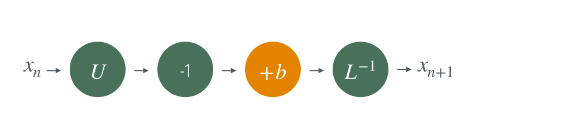{.diagram fig-alt="Traced Gauss-Seidel operations: multiply by U, negate, add b, and solve with L"}

::::
:::: {.column width="52%"}

```{.python}
import numpy as np
import scipy.linalg as spl

def gauss_seidel(A, b, x):
    L = np.tril(A)
    U = np.triu(A, k=1)
    y = U @ x
    z = b - y
    return spl.solve_triangular(L, z)
```

::::
:::

<!-- Keynote slide 55 -->
## Program Transformation {#slide-55}

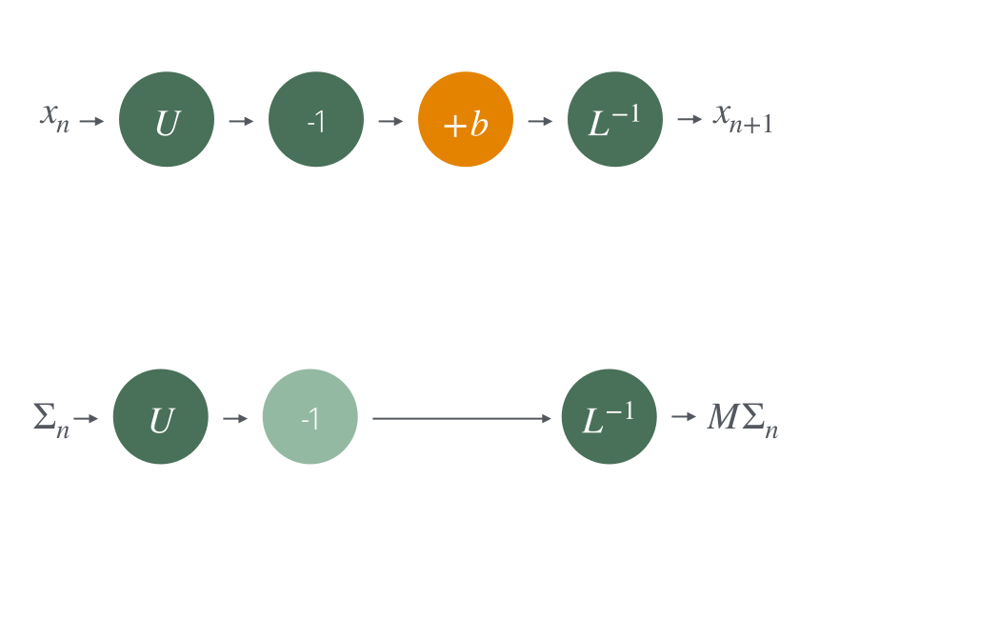{.wide-diagram fig-alt="Affine program and the linear program obtained by removing the shift"}

<!-- Keynote slide 56 -->
## Inverse Priors {#slide-56 .compact}

- This shows how we can use Affine Tracing to generate an implementation of $P^{i}$ and its linear part ${\overline{G}}_{i} = \prod_{j=i}^{1}G_{j}$.

- We have seen that $G_{i} = (I - M_{i}A)$. We have:

$$D_{i} = S(M_{i}) + \sum_{j=1}^{i-1}G_{i:j + 1}S(M_{j})G_{i:j + 1}^{\top}$$

- We need an implementation of $M_{i}$ to compute the downdate.

- For this we use a (more sophisticated) program transformation.

$$G_{i:j} = \prod_{k=i}^{j}G_{j}$$

<!-- Keynote slide 57 -->
## Program Transformation {#slide-57 .compact}

- We need to compute expressions like $VM_{i} = VG_{i}A^{- 1} - VA^{- 1}$, $V \in \mathbb{R}^{d' \times d}$

- Feed this expression into an **e-graph** *(generated from the traced graph)*.

- Represent linear algebra identities as equivalences in the e-graph.

- Generates equivalent representations and extracts the **minimum cost** representation.

<!-- Keynote slide 58 -->
## E-Graph Simplification {#slide-58}

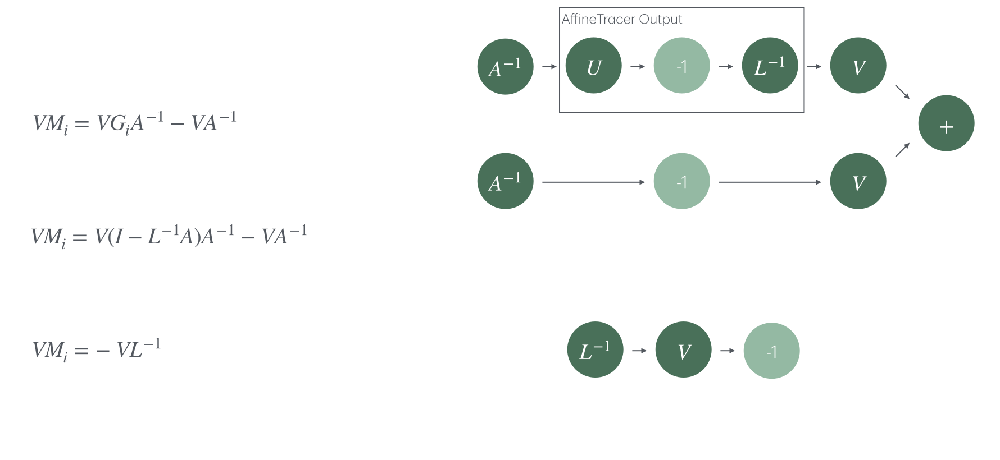{.wide-diagram fig-alt="E-graph simplification from the traced inverse expression to minus V times L inverse"}

<!-- Keynote slide 59 (skipped) -->
## More Complex Transformations {#slide-59 visibility="hidden"}

$$x_{n + 1} = L^{- 1}(b - Ux_{n}) = (I - L^{- 1}A)x_{n} + L^{- 1}b$$

Canonical form

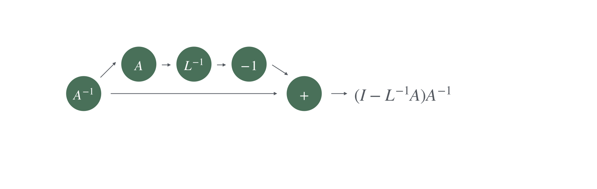{.wide-diagram fig-alt="Canonical form of the affine map and its action on the inverse prior"}

<!-- Keynote slide 60 (skipped) -->
## Automatic Inverse Priors {#slide-60 visibility="hidden"}

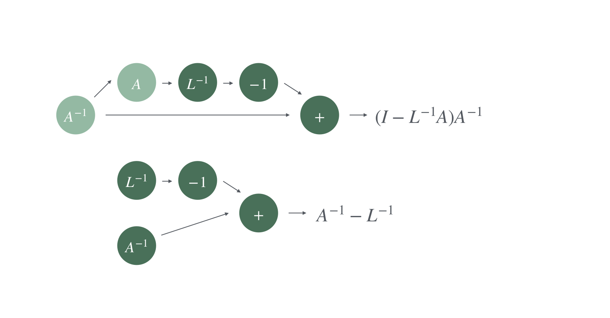{.wide-diagram fig-alt="Equivalent computation graphs for the inverse prior and its downdate"}

<!-- Keynote slide 61 (skipped) -->
## Practical Algorithms {#slide-61 visibility="hidden"}

- Various tools for graph simplification.

- E-graphs1

- Bespoke algorithms?

- Further optimisations possible.

- e.g. cost-specific (for low-dimensional projections).

- More complex applications.

::: {.references}
1\. Willsey, M., Chandrakana Nandi, Yisu Remy Wang, Flatt, O., Panchekha, P., & Tatlock, Z. (2020). Artifact for "Fast and Extensible Equality Saturation." Zenodo. https://doi.org/10.5281/ZENODO.4072013
:::

<!-- Keynote slide 62 -->
## Part 5: Results {#slide-62 .section-slide}


<!-- Keynote slide 63 -->
## AT Implementations can be Faster {#slide-63}

- Comparing traced 2-grid multigrid to a hand-implementation.

{.result-figure fig-alt="Wall-time comparison of ProbNum and AffineTracer for two-grid multigrid"}

<!-- Keynote slide 64 -->
## CAGP Convergence {#slide-64}

- Synthetic test problem.

- Draw a sample from a GP prior (Matern 3/2)

- 100x100 grid of training points in $\lbrack 0,1\rbrack^{2}$

- Multigrid uses 40x40 and 30x30 grids

- 5x5 grid as test set

<!-- Keynote slide 65 -->
## CAGP Convergence {#slide-65}

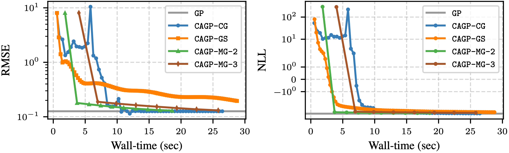{.wide-figure fig-alt="CAGP convergence: RMSE and calibration versus wall time"}

<!-- Keynote slide 66 -->
## ERA5 Regression {#slide-66}

{.panorama fig-alt="ERA5 regression: CAGP-CG, CAGP-GS, CAGP-MG-2, and actual temperature"}

<!-- Keynote slide 67 -->
## Conclusions / Challenges {#slide-67}

- E-graph component brittle, still requires some hand-simplification (but greatly reduced).

- No numerical analysis.

- Everything in the talk relies (intrinsically) on the Gaussian-affine assumption.

- BUT: the fixed point requirement is much more general!

<!-- Keynote slide 68 -->
## Thanks! {#slide-68 .section-slide}

## Papers {#papers-closing}

**Affine Tracing: A New Paradigm for Probabilistic Linear Solvers**<br>
Hegde, Pförtner and Cockayne (NeurIPS 2026)<br>
[arxiv.org/abs/2605.10566](https://arxiv.org/abs/2605.10566)

**Calibrated Computation-Aware Gaussian Processes**<br>
Hegde, Adil and Cockayne (AISTATS 2025)<br>
[proceedings.mlr.press/v258/hegde25a.html](https://proceedings.mlr.press/v258/hegde25a.html)
