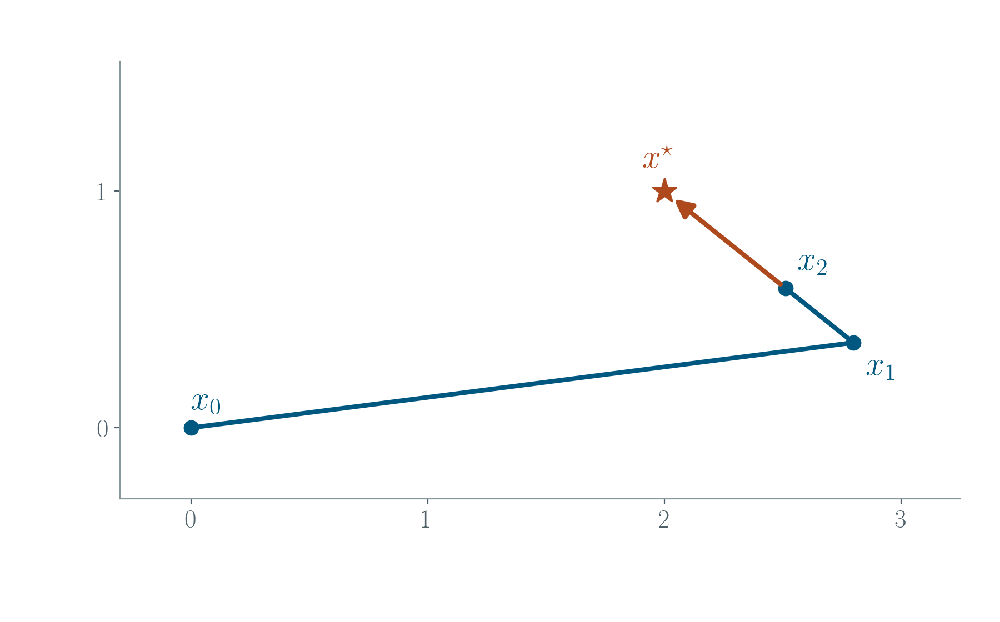
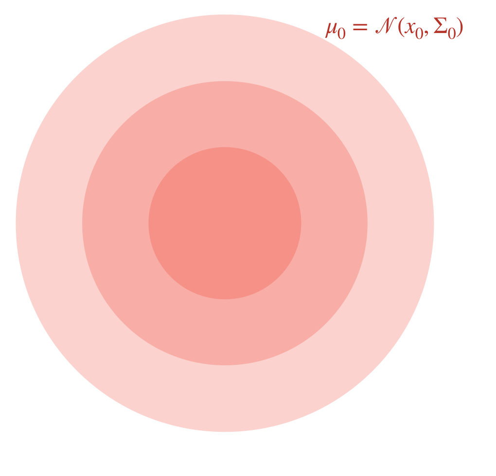
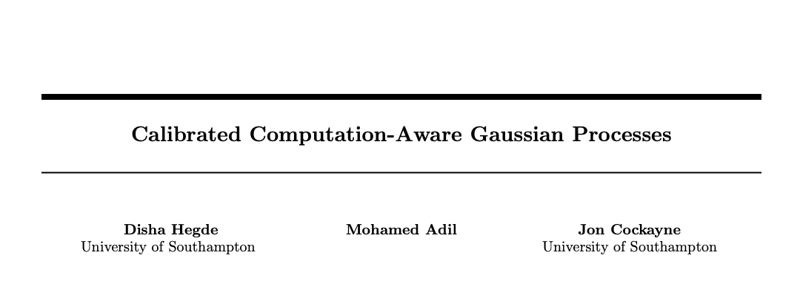
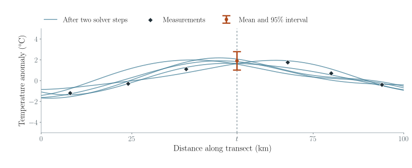
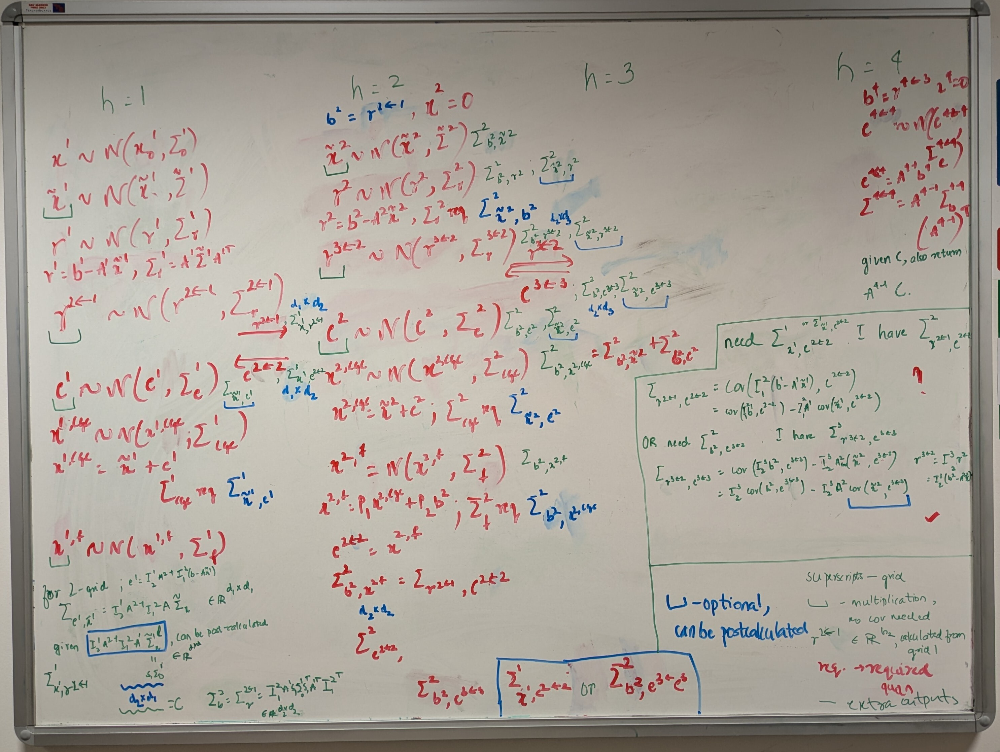
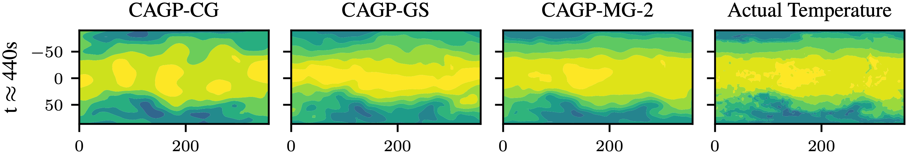

## Affine Tracing {#slide-01 .uos-title .no-heading}

::: {.uos-logo}
{fig-alt="University of Southampton"}
:::

::: {.big-title}
Affine Tracing
:::

::: {.big-subtitle}
A New Paradigm for Implementing Probabilistic Linear Solvers
:::

::: {.author-block}
**Jon Cockayne**<br>
The University of Osaka, 26 November 2026
:::

::: {.notes}
Interior-point and Newton-type methods both require linear solves. We begin with a two-dimensional example to see what remains uncertain when one of those solves stops early.
:::

## Gauss–Seidel for a large linear system {#gauss-seidel-setup}

$$Ax^\star=b, \qquad A=L+U$$

$$Lx_{k+1}=b-Ux_k$$

::: {.notes}
We start from an initial guess $x_0$. Here $L$ is the lower triangular part of $A$, including its nonzero diagonal, and $U$ is strictly upper triangular. Given $x_k$, forward substitution gives the next iterate. I'll show two steps on a two-dimensional example so we can see the path.
:::

## Two steps of Gauss–Seidel {#stopped-solve .no-heading}

```{=html}
<div class="stopped-solve-frame">
  <video class="stopped-solve-plot" src="assets/stopped-solve.mp4" muted playsinline data-autoplay
         aria-label="Gauss–Seidel moves from the origin to x₁ and then to x₂, where the solver stops."></video>
</div>
```

::: {.notes}
Let the two steps play. We stop solving $Ax=b$ at $x_2$. How far, and in which direction, could the solution still be?

Pause here. We know the iterates and can compute the residual. What we would like to describe is the remaining error in the solution.
:::

## The remaining error {#stopped-solve-reveal .no-heading}

```{=html}
<div class="stopped-solve-frame">
  
</div>
```

::: {.notes}
The arrow is the correction $x^\star-x_2$. Here we know the solution because we constructed the example. In a large system, computing the exact correction would finish the solve.

Can the solver describe the error when we stop early? We will use the solver code to propagate a distribution that describes the remaining error.
:::

## Goal {#goal}

- Represent solver error *probabilistically* and *automatically*.
- Propagate it into probabilistic regression methods.

## Papers {#papers-opening}

**Affine Tracing: A New Paradigm for Probabilistic Linear Solvers**<br>
Hegde, Pförtner and Cockayne (NeurIPS 2026)<br>
[arxiv.org/abs/2605.10566](https://arxiv.org/abs/2605.10566)

**Calibrated Computation-Aware Gaussian Processes**<br>
Hegde, Adil and Cockayne (AISTATS 2025)<br>
[proceedings.mlr.press/v258/hegde25a.html](https://proceedings.mlr.press/v258/hegde25a.html)

<!-- Keynote slide 2 -->
## Co-Authors {#slide-02}

- Disha Hegde (Southampton)

- Marvin Pförtner

- Mohamed Adil

- Chris Oates (Newcastle)

- Ilse Ipsen (NC State University)

- Tim Reid

::: {.notes}
Disha Hegde and Marvin Pförtner are co-authors on affine tracing. Disha Hegde and Mohamed Adil are co-authors on calibrated computation-aware Gaussian processes.
:::

<!-- Keynote slide 3 -->
## Outline {#slide-03}

1. Linear systems and GP regression

2. Probabilistic Numerics and Probabilistic Linear Solvers

3. Computation-Aware GPs

4. Tracing the iterate and the right-hand side

5. Results

::: {.notes}
Nonparametric regression, nonlinear, conjugacy, UQ
:::

<!-- Keynote slide 4 -->
## Part 1: Linear Systems {#slide-04 .section-slide}


::: {.notes}
The methods that follow all approximate the solution of a linear system.
:::

<!-- Keynote slide 5 -->
## Linear Systems {#slide-05}

- We focus on linear systems of the form

$$Ax=b, \qquad A\in\mathbb R^{d\times d}.$$

- Dense direct factorisation (LU, QR or Cholesky when applicable) costs $\mathcal O(d^3)$.

- An iterative solver produces approximations $x_0,x_1,\ldots$.

- If a few inexpensive steps give the required accuracy, iteration can save work.

::: {.notes}
The cost comparison depends on the number of iterations and the cost per step. We also want to quantify the error at the chosen stopping point.
:::

<!-- Keynote slide 6 -->
## Why Should You Care? {#slide-06}

- Second order optimisation.

- Linear Programming (e.g. interior point methods).

- Least-squares problems

- ...essentially any numerical pipeline.

::: {.notes}
For example, a Newton step solves a linear system involving the Hessian. The application we will follow today is Gaussian process regression.
:::

<!-- Keynote slide 7 -->
## Big (GP) Regression Problems {#slide-07}

::: {.columns}
:::: {.column width="40%"}

{.figure fig-alt="ERA5 gridded temperature field"}

::::
:::: {.column width="60%"}

- About one million grid values per hourly temperature field.

- Hourly time points since 1940.

- Our experiment uses 36,450 training locations at one time point.

- Dense GP factorisation costs $\mathcal O(d^3)$ for $d$ training sites.

::::
:::

::: {.notes}
ERA5 provides gridded reanalysis fields. The later experiment uses 2-metre air temperature at one time point. The million-value scale refers to the global atmospheric grid at 0.25-degree spacing. [ERA5 dataset](https://cds.climate.copernicus.eu/datasets/reanalysis-era5-single-levels)
:::

<!-- Keynote slide 8 -->
## Predicting temperature at one location {#slide-08}

```{=html}
<div class="temperature-plot">
  
  
</div>
```

$u\sim\Pi_0=\mathcal{GP}(m_0,k_0)$ [$\quad\xrightarrow{\;y=u(X_{\rm tr})+\varepsilon\;}\quad u\mid y\sim\mathcal{GP}(m,k)$]{.fragment data-fragment-index="0"}

::: {.notes}
Imagine measuring temperature along a line. The vertical axis is temperature relative to a reference, so we start with a zero mean. The dashed line marks an unobserved location, $t$. Each blue curve is one possible temperature profile. A Gaussian process (GP) is a random function whose values at any finite collection of locations form a jointly Gaussian vector. Its covariance tells us how temperatures at different locations vary together.

Click to reveal six noisy measurements and condition on them. The orange dot is our predicted temperature anomaly at $t$. The bar is a pointwise 95% interval for the underlying temperature there. This is a synthetic illustration.
:::

<!-- Keynote slide 9 -->
## Gaussian process regression as a linear solve {#slide-09 .compact}

At the measurement sites $X_{\rm tr}$, take independent noise $\varepsilon\sim\mathcal N(0,\sigma^2 I)$.

$$A=k_0(X_{\rm tr},X_{\rm tr})+\sigma^2 I,\qquad k_t=k_0(X_{\rm tr},t).$$

The conditional GP $u\mid y\sim\mathcal{GP}(m,k)$ has

$$\begin{aligned}
m(t) &= m_0(t)+k_t^\top A^{-1}\bigl(y-m_0(X_{\rm tr})\bigr),\\
k(t,t') &= k_0(t,t')-k_t^\top A^{-1}k_{t'}.
\end{aligned}$$

::: {.fragment}
$$\underbrace{Av^\star=y-m_0(X_{\rm tr})}_{\text{solve once for }v^\star}
\qquad\Longrightarrow\qquad m(t)=m_0(t)+k_t^\top v^\star.$$
:::

::: {.notes}
The prior mean is $m_0$ and its covariance function is $k_0$. In the temperature plot we used $m_0=0$. The vector $y$ contains the six measurements. The matrix $A$ is their covariance, including independent measurement noise. The vector $k_t$ gives the prior covariances between the measurement sites and the marked location.

Conditioning a jointly Gaussian vector gives these two formulas. The orange dot is $m(t)$, and the bar extends approximately $1.96\sqrt{k(t,t)}$ on either side. Evaluating the covariance also involves a solve, with right-hand side $k_{t'}$.

Click to isolate the solve for the mean. The weights $v^\star$ are shared across prediction sites. A dense factorisation costs $\mathcal O(d^3)$ for $d$ sites. What happens to the prediction if we stop an iterative solve after two steps?
:::

<!-- Keynote slide 10 (skipped) -->
## Code Demo 1 {#slide-10 .section-slide visibility="hidden"}


::: {.notes}
Use the GP example to show the prediction before and after conditioning on the data.
:::

<!-- Keynote slide 11 (skipped) -->
## GP Approximation {#slide-11 visibility="hidden"}

- We cannot always afford to pay $\mathcal{O}(d^{3})$!

- **GP approximation** methods aim to address this:

- Fourier Features

- Structured Kernel Methods

- SDE-Based (Lindgren)

- Sparse / Inducing Points (FITC / Nystrom / Variational)

::: {.notes}
Each of these approximations exploits structure to reduce the cost of GP inference.
:::

<!-- Keynote slide 12 (skipped) -->
## Challenges {#slide-12 visibility="hidden"}

- There are **few guarantees** on the UQ provided by these methods.

- It can be *very* overconfident [1].

- This talk: Novel GP approximation methods based on applying a **probabilistic linear solver** to solve the linear system and **propagating the uncertainty** to the GP.

- We are able to obtain (subjective) guarantees on the UQ provided.

::: {.references}
1\. Jonathan Wenger et al. "Computation-Aware Gaussian Processes: Model Selection And Linear-Time Inference". In: NeurIPS 2024 (2024). DOI: 10.52202/079017-0984.
:::

::: {.notes}
The question is whether the reported uncertainty reflects the error introduced by the approximation.
:::

<!-- Keynote slide 13 -->
## Part 2: Probabilistic Numerics and Probabilistic Linear Solvers {#slide-13 .section-slide}


::: {.notes}
We now focus on the linear solve itself and the error left by early stopping.
:::

<!-- Keynote slide 14 -->
## Numerical Problems {#slide-14}

- Given a problem space $\mathcal{A}$ and solution space $\mathcal{X}$, a **numerical method** is a function:

$$f:\mathcal{A} \rightarrow \mathcal{X}$$

- For a problem $P \in \mathcal{A}$ with solution $x \in \mathcal{X}$, **good** numerical methods have $f(P) \approx x$.

::: {.notes}
The exact solution is usually unavailable. The numerical method returns an approximation in the solution space.
:::

<!-- Keynote slide 15 -->
## Example: NLA {#slide-15}

- Problem: find $x$ in $Ax = b$.

- $\mathcal{X} = \mathbb{R}^{d}$, $\mathcal{A} = \left\{ (A,b):A \in \mathbb{R}^{d \times d},b \in \mathbb{R}^{d},A\text{invertible} \right\}$

- Measure **approximation error** through the error norm $\parallel f((A,b)) - x \parallel$

::: {.notes}
For a nonsingular matrix the pair of inputs determines a unique solution, so we can define the error of any approximation.
:::

<!-- Keynote slide 16 -->
## Example: NLA {#slide-16}

::: {.columns}
:::: {.column width="64%"}

### Examples of Numerical Methods

- LU Factorisation:

- Dense factorisation costs $\mathcal O(d^3)$, followed by two triangular solves.

- Iterative Methods:

- Richardson iteration: $x_{i+1}=x_i+\omega(b-Ax_i)$.

- Each dense step costs $\mathcal O(d^2)$. Convergence requires $\rho(I-\omega A)<1$ for all starting points.

- Many others - e.g. Krylov methods *(CG)*, multigrid, semi-iterations...

::::
:::: {.column width="36%"}

{.figure fig-alt="Jacobi, Richardson and Gauss-Seidel iterates follow three paths from the origin to the solution at (2, 1)."}

::::
:::

::: {.notes}
In the animation $A$ is symmetric positive definite with eigenvalues 0.4 and 1.4. The unit Richardson step therefore converges here. For a general positive definite $A$, choose $0<\omega<2/\lambda_{\max}(A)$.
:::

<!-- Keynote slide 17 -->
## Early Stopping {#slide-17}

::: {.columns}
:::: {.column width="68%"}

- An iterative method is a sequence

- $(x_{i})$ $x_{i} \in \mathbb{R}^{d}$

- Running to convergence can still be expensive.

- Terminating an iteration early leaves error unquantified.

- Existing "worst case" bounds are typically very conservative.

::::
:::: {.column width="32%"}

{.diagram fig-alt="Iterates approaching the solution"}

::::
:::

::: {.notes}
The residual is available at every step. Turning it into a sharp error estimate requires information about the matrix.
:::

<!-- Keynote slide 18 -->
## Probabilistic Numerics {#slide-18}

::: {.columns}
:::: {.column width="68%"}

- A **probabilistic iterative method** is a sequence

- $(\mu_{i})$ $\mu_{i} \in \mathcal{P}(\mathbb{R}^{d})$

- "Uncertainty" describes the error.

- Probabilistic numerical methods are good if:

- They converge quickly (i.e. $\mu_{i}(B_{\epsilon}^{\mathsf{c}}(x^{\star}))$ is small) **and**

- $\mu_{i}$ *typically* provides a *good representation of the error*.

::::
:::: {.column width="32%"}

{.diagram fig-alt="Probability distributions describing the error of successive iterates"}

::::
:::

::: {.notes}
The distribution should concentrate near the solution as the solver converges. At an earlier step we also care about whether its spread describes the remaining error.
:::

<!-- Keynote slide 19 -->
## 2.1: Building PLSs {#slide-19 .section-slide}


::: {.notes}
We will construct a probabilistic solver by pushing a distribution through a classical iteration, then compare this with conditioning on linear observations.
:::

<!-- Keynote slide 20 -->
## Probabilistic Iterative Methods for Linear Systems {#slide-20 .no-heading}

{.paper fig-alt="Probabilistic Iterative Methods for Linear Systems, article title page"}

::: {.notes}
We will use a classical solver step to update a distribution over solutions.
:::

<!-- Keynote slide 21 -->
## Iterative Methods {#slide-21}

- A (degree 1) iterative method is a sequence of maps $(P_{i})_{i = 1}^{\infty}$, $P_{i}:\mathbb{R}^{d} \rightarrow \mathbb{R}^{d}$.

- Given an initial iterate $x_{0}$, we generate the sequence $x_{i} = P_{i}(x_{i - 1})$.

- We let $P^{i} = P_{i} \circ \ldots \circ P_{1}$, i.e. $x_{i} = P^{i}(x_{0})$.

::: {.notes}
Each map advances one step. Their composition takes the initial guess to the current iterate.
:::

<!-- Keynote slide 22 -->
## Pushforward Methods {#slide-22}

::: {.columns}
:::: {.column width="68%"}

- We lift the maps to probability space.

- Given an initial random variable $X_{0}$, $X_{i} = P_{i}(X_{i - 1})$.

- If $X_{0} \sim \mu_{0}$, $X_{i} \sim \mu_{i}$ where $\mu_{i} = (P_{i})_{\sharp}\mu_{i - 1}$.

- (Hence why these are called "pushforward methods")

::::
:::: {.column width="32%"}

{.diagram fig-alt="Pushforward maps between iterates and probability measures"}

::::
:::

::: {.notes}
Apply the same deterministic iteration map to every draw from the preceding distribution. The law of the resulting draws is its pushforward.
:::

<!-- Keynote slide 23 -->
## Gaussian-Affine PLS {#slide-23 .compact}

::: {.columns}
:::: {.column width="68%"}

- Many iterative methods are affine:

$$P_{i}(x) = G_{i}x + f_{i}\quad G_{i} \in \mathbb{R}^{d \times d},f_{i} \in \mathbb{R}^{d}$$

::: {.fragment data-fragment-index="0"}
- Using a Gaussian prior $\mu_{0} = \mathcal{N}(x_{0},\Sigma_{0})$ we have

$$\mu_{i} = \mathcal{N}(x_{i},\Sigma_{i})\quad\Sigma_{i} = G_{i}\Sigma_{i - 1}G_{i}^{\top}$$
:::

::::
:::: {.column .fragment data-fragment-index="0" width="32%"}

{.diagram fig-alt="Expectation commutes with affine pushforward maps"}

::::
:::

::: {.notes}
The mean follows the ordinary iteration. The linear part of the map transports deviations from the mean, which gives the covariance update.
:::

<!-- Keynote slide 24 -->
## Approach 2: Bayesian Methods {#slide-24}

- Phrase this as a **Bayesian inference problem**:

- Take $x\sim\mathcal N(x_0,\Sigma_0)$ with $\Sigma_0$ positive definite.

- Condition on **data** of the form $s_{i}^{\top}Ax^{\star} = s_{i}^{\top}b$, $i = 1,\ldots,m$, where the fixed matrix $S_{m} = \lbrack s_{1},\ldots,s_{m}\rbrack \in \mathbb{R}^{d \times m}$ has rank $m$.

::: {.notes}
Each search direction supplies one exact scalar observation of the unknown solution. Stacking them gives the observation matrix on the next slide.
:::

<!-- Keynote slide 25 -->
## Bayesian PLS {#slide-25 .compact}

Write $H=S_m^\top A$ and $C=H\Sigma_0 H^\top$. Conditioning on $Hx=S_m^\top b$ gives

$$\begin{aligned}
x\mid Hx=S_m^\top b &\sim \mathcal N(x_m,\Sigma_m),\\
x_m &= x_0+\Sigma_0 H^\top C^{-1}S_m^\top(b-Ax_0),\\
\Sigma_m &= \Sigma_0-\Sigma_0 H^\top C^{-1}H\Sigma_0.
\end{aligned}$$

The dense update costs $\mathcal O(md^2+m^3)$ and factors an $m\times m$ matrix $C$.

::: {.notes}
The projected residual updates the prior mean. In exact arithmetic the resulting distribution is supported on the affine space of solutions of the observed constraints.
:::

<!-- Keynote slide 26 -->
## Bayesian Methods are Pushforward Methods {#slide-26 .compact}

::: {.theorem}
**[Theorem 3.1](https://arxiv.org/html/2605.10566v2)**

A Bayesian linear solver with Gaussian iterates can be represented by a sequence of affine iteration maps.

Conversely, suppose the affine iteration fixes $x^\star$. If the linear part $G_i\cdots G_1$ of the composed map is the $\Sigma_0^{-1}$-orthogonal projection onto $\ker(S_i^\top A)$, its pushforward gives the Bayesian posterior for those directions.
:::

::: {.notes}
The projection describes the whole sequence through step $i$. Its range consists of perturbations invisible to all the observations so far.
:::

<!-- Keynote slide 27 -->
## 2.2: Calibrated PLSs {#slide-27 .section-slide}


::: {.notes}
Does the uncertainty reported by a probabilistic linear solver agree with the errors it makes?
:::

<!-- Keynote slide 28 -->
## Calibration of Gaussians {#slide-28}

::: {.columns}
:::: {.column width="58%"}

<div class="calibration-figure" role="group" aria-label="Gaussian calibration at a fixed iteration across four prior draws">
  
  
  
  
  
  
</div>

::::
:::: {.column width="42%"}

::: {.fragment .calibration-build data-fragment-index="0"}
Fix iteration $i$. Each run $j$ reports
$$\mu_i^{(j)}=\mathcal N(x_i^{(j)},\Sigma_i)$$
with the same full-rank covariance.
:::

::: {.fragment .calibration-build data-fragment-index="1"}
Draw $x^{\star(j)}\sim\mu_0$, set $b^{(j)}=Ax^{\star(j)}$, and standardise the error.
$$z^{(j)}=\Sigma_i^{-1/2}(x_i^{(j)}-x^{\star(j)}).$$
:::

::: {.fragment .calibration-build data-fragment-index="2"}
Calibration requires $z^{(j)}\sim\mathcal N(0,I_d)$ across prior draws.
:::

::::
:::

::: {.notes}
The blue ellipses have the same size and orientation because the covariance is fixed. Their centres change with the right-hand side. The red points are the true solutions. Repeated runs let us test the distribution of the standardised errors.
:::

<!-- Keynote slide 29 -->
## Calibration of Gaussian-Affine PLSs {#slide-29 .compact}

::: {.theorem}
**Strong calibration ([Definition 2.1](https://arxiv.org/html/2605.10566v2))**

Let $\mu_{i} = \mathcal{N}(x_{i},\Sigma_{i})$ be the PLS output with $\Sigma_{i}$ independent of $x^{\star}$. Let the columns of $R$ and $N$ form bases for the range and kernel of $\Sigma_{i}$, respectively, and let $r=\operatorname{rank}(\Sigma_{i})$.

The PLS is **strongly calibrated** if, for $x^{\star} \sim \mu_{0}$ and $b=Ax^{\star}$,

$$\begin{aligned}
(R^{\top}\Sigma_{i}R)^{-1/2}R^{\top}(x_{i}-x^{\star}) &\sim \mathcal{N}(0,I_{r}), \\
N^{\top}(x_{i}-x^{\star}) &= 0.
\end{aligned}$$
:::

::: {.notes}
The Gauss–Seidel step has $G=-L^{-1}U$ with strictly upper triangular $U$, so $G\Sigma_0G^\top$ is singular even when $\Sigma_0$ is positive definite. Test the standardised error on the range of the covariance. In directions with zero posterior variance, calibration requires zero error.
:::

<!-- Keynote slide 30 -->
## Calibration of Gaussian-Affine PLSs {#slide-30}

::: {.theorem}
**[Theorem 3.3](https://arxiv.org/html/2605.10566v2)**

Fix the iteration $i$. Let $\mu_{0}=\mathcal{N}(x_{0},\Sigma_{0})$ with $\Sigma_{0}$ symmetric positive definite. For an affine iterative method solving $Ax^{\star}=b$, let $P^{i}$ be the map taking $x_{0}$ to $x_{i}$. Assume $P^{i}(x^{\star})=x^{\star}$ and that its linear part is independent of $b$.

Then the associated PIM $\mu_{i}=(P^{i})_{\sharp}\mu_{0}$ is **strongly calibrated**.
:::

::: {.notes}
The fixed point property makes the error follow the same linear map as the prior uncertainty. This explains why calibration can hold at an early stopping iteration.
:::

<!-- Keynote slide 31 -->
## Part 3: Computation-Aware GPs {#slide-31 .section-slide}


::: {.notes}
We now use a calibrated solver for the linear system inside GP regression.
:::

<!-- Keynote slide 32 -->
## Computation-Aware Gaussian Processes {#slide-32 .no-heading}

{.paper-half fig-alt="Paper on computation-aware Gaussian processes"}

{.paper-half fig-alt="Paper on computation-aware Gaussian processes"}

::: {.notes}
Stopping the solve early leaves uncertainty in the GP prediction. Marginalising over the solver output carries that uncertainty into the predictive covariance.
:::

<!-- Keynote slide 33 -->
## Recap: Gaussian Processes {#slide-33 .compact}

$$\begin{aligned}
u \mid y &\sim \Pi^y=\mathcal{GP}(m,k) \\
m(t) &= m_0(t)+k_t^\top A^{-1}\bigl(y-m_0(X_{\rm tr})\bigr) \\
k(t,t') &= k_0(t,t')-k_t^\top A^{-1}k_{t'}.
\end{aligned}$$

Here $k_t=k_0(X_{\rm tr},t)$ and $A=k_0(X_{\rm tr},X_{\rm tr})+\sigma^2 I$.

- Dense Cholesky factorisation costs $\mathcal O(d^3)$.

- Goal: fast, calibrated GP posteriors.

<!-- Keynote slide 34 -->
## Reparameterisation {#slide-34 .compact}

Under the GP model, the centred observations and exact weights have laws
$$b=y-m_0(X_{\rm tr})\sim\mathcal N(0,A),\qquad
v^\star=A^{-1}b\sim\nu_0=\mathcal N(0,A^{-1}).$$

Given $v^\star=w$, the exact conditional GP has covariance $k$ and mean
$$m(t;w)=m_0(t)+k_t^\top w.$$

After $i$ steps, the solver reports $\nu_i=\mathcal N(\bar v_i,\Sigma_i)$. The CAGP averages the conditional GP over these weights.
$$\widetilde\Pi_i=\int \mathcal{GP}\bigl(m(\cdot;w),k\bigr)\,\nu_i(dw).$$

::: {.notes}
Before observing the data, multiplying the centred data by $A^{-1}$ gives weights with covariance $A^{-1}AA^{-1}=A^{-1}$. Once we observe $y$, the exact weights are determined. The solver distribution describes our numerical uncertainty about those weights. In the temperature example we stop at $i=2$.
:::

<!-- Keynote slide 35 -->
## What does an unfinished solve add? {#slide-35}

```{=html}
<div class="temperature-plot">
  
  
</div>
```

::: {.fragment data-fragment-index="0"}
$$\tilde k_2(t,t)=\underbrace{k(t,t)}_{\text{exact-solve variance}}+\underbrace{k_t^\top\Sigma_2 k_t}_{\text{solver contribution}}.$$
:::

::: {.notes}
This is the same transect, the same six measurements and the same location. Recall the orange interval with an exact solve.

Click to stop after two Gauss–Seidel steps. The solver gives the weights a mean $\bar v_2$ and covariance $\Sigma_2$. The predicted mean is now $k_t^\top\bar v_2$. Averaging over the uncertain weights adds the variance of their contribution, $k_t^\top\Sigma_2 k_t$, to the exact GP variance. This is marginalisation. The bar uses the square root of the total variance, so standard deviations do not add.

For this example we start the solver weights from $\mathcal{N}(0,A^{-1})$. Writing $\Sigma_2=A^{-1}-D_2$ makes the inverse terms cancel in the predictive variance, leaving $k_0(t,t)-k_t^\top D_2 k_t$. This is why we will need the downdate $D_2$.
:::

<!-- Keynote slide 36 -->
## Calibration of CAGPs {#slide-36 .compact}

::: {.theorem}
**Theorem (Theorem 4 of \[1\])**

Write DGM for the data-generating model. Assume that the GP model is strongly calibrated (in the sense of \[2\]) for $(\Pi_0,\text{DGM})$, and that the PLS is strongly calibrated for $\nu_0=\mathcal N(0,A^{-1})$ (plus some additional mild technical conditions).

Then the CAGP posterior is strongly calibrated for $(\Pi_0,\text{DGM})$.
:::

::: {.references}
\[1\] Hegde, D., Adil, M., & Cockayne, J. (2025). Calibrated computation-aware Gaussian processes. *AIStats 2025.* doi:10.48550/ARXIV.2410.08796

\[2\] Cockayne, J., Graham, M. M., Oates, C. J., Sullivan, T. J., & Teymur, O. (2022). Testing Whether a Learning Procedure is Calibrated. *Journal of Machine Learning Research*, *23*(203), 1--36. Retrieved from http://jmlr.org/papers/v23/21-1065.html
:::

<!-- Keynote slide 37 -->
## The Inverse Prior {#slide-37}

How does the solver update the covariance of the GP weights?

::: {.theorem}
**[Lemma 3.2](https://arxiv.org/html/2605.10566v2)**

Let $(P_{j})$ be a sequence of first-order affine iteration maps for $Ax^{\star}=b$ with $P_{j}(x^{\star})=x^{\star}$ for every $j$. For each $i$ there is a matrix $\overline{M}_{i}$ such that

$$P^{i}(x) = (I - \overline{M}_{i}A)x + \overline{M}_{i}b.$$
:::

::: {.fragment}
For the GP weights, $A$ is symmetric positive definite and $\nu_0=\mathcal N(0,A^{-1})$. At step $i$,

$$\Sigma_{i} = A^{-1} - D_{i},$$

where the downdate $D_{i}$ can be expressed in terms of $A$ and $\overline{M}_{i}$.
:::

<!-- Keynote slide 38 -->
## ...but how do we get the downdate? {#slide-38}

Fix $A$ and the number of steps $i$. If the affine step coefficients stay fixed as $b$ varies, the coefficient of $b$ in the composed map is $\overline{M}_i$. It determines the downdate

$$D_{i} = {\overline{M}}_{i} + {\overline{M}}_{i}^{\top} - {\overline{M}}_{i}A{\overline{M}}_{i}^{\top}$$

Where does $\overline{M}_i$ appear in the solver code we already have?

<!-- Keynote slide 39 (skipped) -->
## Using the Inverse Prior {#slide-39 visibility="hidden"}

For symmetric positive definite $A$, take the inverse prior $\nu_0=\mathcal N(0,A^{-1})$.

For the fixed-point affine iteration, $G_i=I-M_i A$. The propagated covariance has the form $A^{-1}-D_i$.

The traces give operator actions for computing the mean and projected downdate without forming $A^{-1}$.

<!-- Keynote slide 40 (skipped) -->
## 3.1 PLSs with Inverse Priors {#slide-40 .section-slide visibility="hidden"}


<!-- Keynote slide 41 (skipped) -->
## Computing the Downdate {#slide-41 visibility="hidden"}

- Downdates can typically be computed without $A^{- 1}$ but may still cost $\mathcal{O}(d^{3})$.

- At $d_{\rm te}$ test points $X_*$, let $V=k_0(X_*,X_{\rm tr})\in\mathbb R^{d_{\rm te}\times d}$. For weights $w\sim\nu_i$,

$$Vw\sim\mathcal N\bigl(V\bar v_i,\,V(A^{-1}-D_i)V^\top\bigr).$$

- With $d_{\rm te}\le d$ and dense Gauss–Seidel steps, updating the projected downdate $VD_iV^\top$ costs $\mathcal O(d_{\rm te}d^2)$ per step.

<!-- Keynote slide 42 (skipped) -->
## With Bayesian PLSs {#slide-42 .compact visibility="hidden"}

- Example: $v^\star\sim\nu_0=\mathcal{N}(0,A^{-1})$, data $S_{m}^{\top}Av^\star = S_{m}^{\top}b = S_{m}^{\top}(y - m_{0}(X_{\rm tr}))$.

- Posterior:

$$\begin{aligned}
v^\star \mid S_{m}^{\top}b &\sim \nu_{m} = \mathcal{N}({\overline{v}}_{m},A^{-1} - D_{m}) \\
\overline{v}_{m} &= S_{m}(S_{m}^{\top}AS_{m})^{- 1}S_{m}^{\top}b \\
D_{m} &= S_{m}(S_{m}^{\top}AS_{m})^{- 1}S_{m}^{\top}
\end{aligned}$$

- We can compute ${\overline{v}}_{m}$ and $D_{m}$ **without** access to $A^{-1}$.

<!-- Keynote slide 43 (skipped) -->
## Challenge 1: Implementation {#slide-43 visibility="hidden"}

{.wide-diagram fig-alt="CAGP-GS algorithm annotated with its triangular solves and computational cost"}

<!-- Keynote slide 44 (skipped) -->
## Challenge 2:  "Simple" Affine-Gaussian PLS typically converge slowly. {#slide-44 .section-slide visibility="hidden"}


<!-- Keynote slide 45 (skipped) -->
## CAGP convergence comparison {#slide-45 .no-heading visibility="hidden"}

{.wide-figure fig-alt="Convergence comparison of CAGP-GS, CAGP-CG and CAGP-Rand"}

<!-- Keynote slide 46 (skipped) -->
## Code Demo 2 {#slide-46 .section-slide visibility="hidden"}


<!-- Keynote slide 47 (skipped) -->
## The "Marginalisation Trick" {#slide-47 .compact .tiny-math visibility="hidden"}

### Details

For $\nu_i=\mathcal N(\bar v_i,A^{-1}-D_i)$ the mixture is

$$\widetilde\Pi_i=\int\mathcal{GP}\bigl(m(\cdot;w),k\bigr)\,\nu_i(dw)
=\mathcal{GP}(\tilde m_i,\tilde k_i).$$

$$\tilde m_i(t)=m_0(t)+k_t^\top\bar v_i.$$

$$\begin{aligned}
\tilde k_i(t,t') &= k(t,t')+k_t^\top(A^{-1}-D_i)k_{t'}\\
&= k_0(t,t')-k_t^\top A^{-1}k_{t'}+k_t^\top(A^{-1}-D_i)k_{t'}\\
&= k_0(t,t')-k_t^\top D_i k_{t'}.
\end{aligned}$$

<!-- Keynote slide 48 (skipped) -->
## "Computational Uncertainty" {#slide-48 visibility="hidden"}

- Consider $\tilde{k}_i(X_*,X_*)$ for some test set $X_* \in \mathcal{X}^{d_{\rm te}}$. Then

$$\tilde{k}_i(X_*,X_*) \succeq k(X_*,X_*)$$

- We interpret the difference $\tilde{k}_i - k$ as "computational uncertainty".

- Theoretical guarantees that $\tilde{k}_i$ provides **conservative** UQ (e.g. \[1\]).

::: {.references}
Jonathan Wenger, Geoff Pleiss, Marvin Pfortner, Philipp Hennig, & John P. Cunningham (2022). Posterior and Computational Uncertainty in Gaussian processes. In Advances in Neural Information Processing Systems (NeurIPS).
:::

<!-- Keynote slide 49 -->
## Part 4: Automating PLS Implementation {#slide-49 .section-slide}


<!-- Keynote slide 52 -->
## How quickly does the mean converge? {#slide-52}

{.wide-figure fig-alt="Mean error convergence of multigrid, Gauss-Seidel, and conjugate gradients"}

The vertical axis is the Euclidean distance between the exact and approximate GP posterior means at the evaluation sites.

::: {.notes}
Multigrid (MG) reduces this error faster per iteration than Gauss–Seidel (GS) in this example. Conjugate gradients (CG) is shown for comparison. A multigrid cycle costs more than one smoothing step. Next we look inside a cycle to see what uncertainty propagation requires.
:::

<!-- Keynote slide 50 -->
## One multigrid cycle {#slide-50}

::: {.columns}
:::: {.column width="62%"}

```{.python}
# Multigrid pseudocode
def multigrid(x_l, b_l):
    s_l = pre_smooth(A_l, b_l, x_l)
    r_l = b_l - A_l @ s_l
    r_next = restrict(r_l)
    e_next = multigrid(0, r_next)
    x_l = s_l + interpolate(e_next)
    return post_smooth(A_l, b_l, x_l)
```

::::
:::: {.column width="38%"}

The smoothed iterate and the coarse-grid correction both depend on the same input $x_\ell$.

::::
:::

<!-- Keynote slide 51 -->
## Propagating uncertainty through multigrid by hand {#slide-51}

::: {.columns}
:::: {.column width="35%"}

Adding the correction to the smoothed iterate requires their cross-covariance.

::::
:::: {.column width="65%"}

{.figure fig-alt="Whiteboard derivation tracking cross-covariances through multigrid"}

::::
:::

<!-- Keynote slide 53 -->
## Trace the solver twice {#slide-53}

Fix $A$. Suppose the step is jointly affine in $(x,b)$ with coefficients independent of both inputs, and fixes $A^{-1}b$ for every $b$. Then

$$\phi_i(x,b)=G_i x+M_i b, \qquad G_i=I-M_i A.$$

::: {.fragment}
- Trace the **iterate** $x$ with $b$ fixed to get the action of $G_i$.
- Trace the **right-hand side** $b$ with $x$ fixed to get the action of $M_i$.

Disha Hegde, PhD thesis, §3.10.1.2.
:::

::: {.notes}
We hold $A$ and the step coefficients fixed as we vary $x$ or $b$. The step is affine in those inputs, so the changes we trace are exact. Tracing the composed routine in $b$ would give the accumulated $\overline{M}_i$ from the inverse-prior slide. We will use the individual steps so we can update the downdate as we iterate.
:::

<!-- Keynote slide 54 -->
## Trace the iterate in Gauss–Seidel {#slide-54 .compact}

::: {.columns}
:::: {.column width="58%"}

```{.python code-line-numbers="7-9"}
from numpy import tril, triu
from scipy.linalg import solve_triangular

def gauss_seidel(A, b, x):
    L = tril(A)
    U = triu(A, k=1)
    y = U @ x
    z = b - y
    return solve_triangular(L, z, lower=True)
```

::::
:::: {.column width="42%"}

Hold $b$ fixed and change $x$ by $h$.

$$\begin{aligned}
\Delta y &= Uh \\
\Delta z &= -Uh \\
\Delta x_{\rm next} &= -L^{-1}Uh = G h .
\end{aligned}$$

::::
:::

::: {.notes}
The triangular solve applies $L^{-1}$ to the change in its input. This same $G$ propagates uncertainty through one step as $G\Sigma G^\top$.

We run the same solver code twice, first with a symbolic iterate and then with a symbolic right-hand side. Each run records the operations on that input, giving us code that applies $G$ or $M$.
:::

<!-- Keynote slide 55 -->
## Trace the right-hand side in Gauss–Seidel {#slide-55 .compact}

::: {.columns}
:::: {.column width="58%"}

```{.python code-line-numbers="8-9"}
from numpy import tril, triu
from scipy.linalg import solve_triangular

def gauss_seidel(A, b, x):
    L = tril(A)
    U = triu(A, k=1)
    y = U @ x
    z = b - y
    return solve_triangular(L, z, lower=True)
```

::::
:::: {.column width="42%"}

Hold $x$ fixed and change $b$ by $q$.

$$\begin{aligned}
\Delta y &= 0 \\
\Delta z &= q \\
\Delta x_{\rm next} &= L^{-1}q = M q .
\end{aligned}$$

::::
:::

::: {.notes}
The change enters one line later. The triangular solve now acts directly on $q$, so $M=L^{-1}$. For multigrid the same procedure follows the change in $b$ through smoothing, restriction, the coarse solve and interpolation.
:::

<!-- Keynote slide 56 -->
## Trace to Downdate {#slide-56 .compact}

For the inverse prior $\Sigma_0=A^{-1}$, start with $D_0=0$. Each step gives

$$D_i =
\underbrace{G_i D_{i-1} G_i^\top}_{\text{propagate with the }x\text{-trace}}
+ \underbrace{M_i+M_i^\top-M_i A M_i^\top}_{\text{update with the }b\text{-trace}}.$$

::: {.fragment}
At test points $X_*$, set $V=k_0(X_*,X_{\rm tr})$. The predictive covariance is

$$\tilde{k}_i(X_*,X_*)=k_0(X_*,X_*)-V D_i V^\top.$$
:::

::: {.notes}
Substitute $\Sigma_{i-1}=A^{-1}-D_{i-1}$ into $\Sigma_i=G_i\Sigma_{i-1}G_i^\top$ and use $G_i=I-M_iA$ with symmetric positive definite $A$. For the projection, the transpose traces give $Z=VG_i$ and $W=VM_i$. The two terms become $ZD_{i-1}Z^\top$ and $WV^\top+VW^\top-WAW^\top$. This uses operator actions throughout and never forms $G_i$, $M_i$ or $A^{-1}$. For a stationary step, the same two traces can be reused at every iteration (Hegde, Algorithm 10).
:::

<!-- Keynote slide 62 -->
## Part 5: Results {#slide-62 .section-slide}


<!-- Keynote slide 63 -->
## Faster Implementation {#slide-63}

Twenty multigrid cycles from $\mathcal{N}(0,I)$. The $x$-trace propagates the covariance through each cycle.

{.result-figure fig-alt="Wall-time comparison of ProbNum and AffineTracer for two-grid multigrid"}

::: {.notes}
We ran the same twenty two-grid multigrid cycles both ways. Tracing the iterate took less time than the hand-coded covariance propagation across the system sizes shown. This experiment uses the first of the two traces, the one with respect to the iterate.
:::

<!-- Keynote slide 64 -->
## CAGP Convergence {#slide-64}

- Synthetic test problem.

- Draw a sample from a GP prior (Matérn 3/2)

- 100x100 grid of training points in $\lbrack 0,1\rbrack^{2}$

- Both multigrid solvers use a $30 \times 30$ coarse grid. The three-grid solver adds a $40 \times 40$ intermediate grid.

- 5x5 grid as test set

<!-- Keynote slide 65 -->
## Convergence Results {#slide-65 .compact}

{.wide-figure fig-alt="RMSE and negative log likelihood against wall time. The two-trace two-grid and three-grid runs are labelled AFT."}


::: {.notes}
Follow the two three-grid curves in the left panel. The purple curve (MG-3-AFT) uses both traces. It reaches a root mean square error of about 0.12 in roughly 20 seconds. The brown curve (MG-3), the original three-grid implementation, takes about 35 seconds to reach the same error.

Disha Hegde, PhD thesis, Figure 3.17. The figure shows results from the second iteration onward. Compare each AFT curve with the original run at the same number of grid levels.
:::

<!-- Keynote slide 66 -->
## ERA5 Regression {#slide-66}

{.panorama fig-alt="ERA5 regression: CAGP-CG, CAGP-GS, CAGP-MG-2, and actual temperature"}

::: {.notes}
These are posterior mean temperatures from the original solvers after about 440 seconds each. We fitted one time point using 36,450 locations from the ERA5 archive shown at the start of the talk. Point to the northern edge of the warm equatorial band in the reference field on the right, then follow that edge across the three estimates. The two-grid map uses the original multigrid implementation.
:::

<!-- Keynote slide 67 -->
## Conclusions / Challenges {#slide-67}

- A single solver step supplies both operators. Trace $x$ to propagate uncertainty and $b$ to compute the inverse-prior downdate.
- For fixed $A$, the step must be affine in its inputs with fixed coefficients. Gauss–Seidel and multigrid with affine components satisfy this condition.
- At a fixed iteration $i$, a Gaussian prior gives strong calibration when the affine map fixes $x^\star$ and its linear part is independent of $b$.
- Convergence rates for the multigrid CAGP remain an open question here.

<!-- Keynote slide 68 -->
## Thanks! {#slide-68 .section-slide}

## Papers {#papers-closing}

**Affine Tracing: A New Paradigm for Probabilistic Linear Solvers**<br>
Hegde, Pförtner and Cockayne (NeurIPS 2026)<br>
[arxiv.org/abs/2605.10566](https://arxiv.org/abs/2605.10566)

**Calibrated Computation-Aware Gaussian Processes**<br>
Hegde, Adil and Cockayne (AISTATS 2025)<br>
[proceedings.mlr.press/v258/hegde25a.html](https://proceedings.mlr.press/v258/hegde25a.html)
